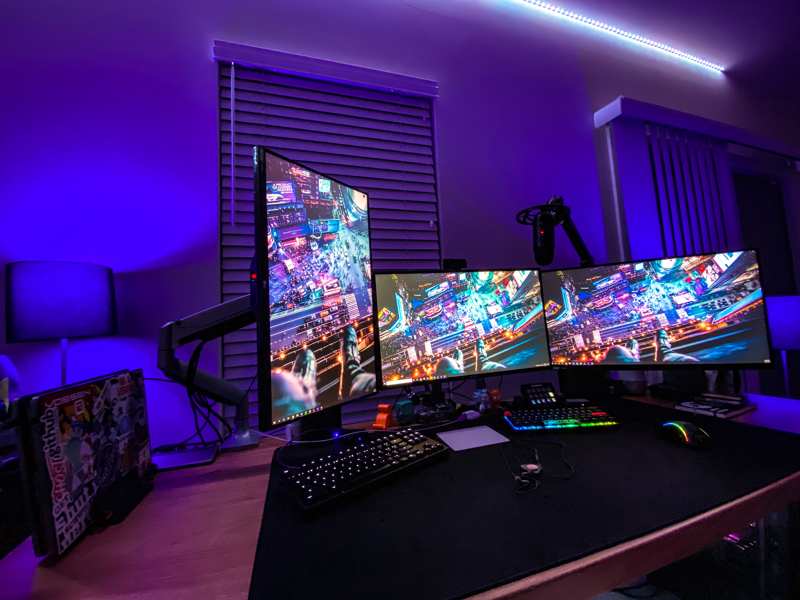

<center>
<p align="center">

# 👋 Kyle Mueller 

</p>


</center>

Hi, I'm **Kyle Mueller** — a Staff Infrastructure Engineer based in Northern Virginia, just outside Washington, D.C. I specialize in DevOps, Platform Engineering, and SRE (whatever it's called this week). I'm passionate about working with both hardware infrastructure and the code that orchestrates it all. Always learning, always building.

Check out my 🌳 [Linktree](https://linktr.ee/lostcuaz) for referrals, recommendations, and social links! 

### 🧰 My Workspace

My home office setup — currently on version 7 and counting. 


<!--
_O = Office Equipment | S = Shared via USB Switch_
```
- Asus ROG PG279Q (Center)
- LG Ultragear 27GL850 (Wings)
- Ducky Mecha Mini
- CODE by WASD Keyboard (O)
- Glorious PC Model D
- Apple Trackpad (O)
- Sony RX100 MK6 (Webcam Util) (S)
- Logitech Cam (S)
- Blue Yeti USB (S)
- UPLIFT Height Adjustable Standing Desk
``` -->
**MacBooks (Daily Drivers)**

 
 

**Windows Gaming Rig**


**Linux Dev Box**


**Homelab Cluster (3x)**

 


<!--
```
- Intel Core i9-11900K 8-Core
- MSI MPG Z590 Gaming Carbon WiFi
- Corsair Vengeance RGB 32GB DDR4 3200
- Gigabyte GeForce RTX 3070Ti
- Western Digital SN850 2TB NVME
- SAMSUNG 970 EVO M.2 1TB NVME (SSD)
- SAMSUNG 870 1TB (SSD)
- Corsair Hydro Series H110i Water/Liquid CPU Cooler
- Elgato 4k Capture Card
- EVGA SuperNOVA 750W Platinum
- Corsair 4000D Airflow
```
-->
### 🚧 Current Projects

- **HashiCorp Ecosystem** — Deep-diving into Terraform, Vault, Nomad, Consul, and other HashiCorp tools to build production-grade automation.

- **Multi-Cloud Terraform** — Experimenting with Azure infrastructure alongside AWS and DigitalOcean to expand cloud expertise. 


### 📚 Learning Focus

Currently expanding skills in:

- **Python** — Automation and tooling
- **Ansible** — Configuration management
- **Vault** — Secrets management
- **Security** — Infrastructure hardening
- **Networking** — BGP, datacenter architecture
- **Terraform** — Infrastructure as Code

### 📓 Resources

Check out my [📓 Learning Notebook](./notebooks/learning.md) — a curated collection of tutorials, guides, and resources across DevOps, SRE, and infrastructure topics. 

### 🌎 Travel & Conferences

Active in the DevOps and SRE community, attending conferences and meetups focused on infrastructure automation, monitoring, and reliability engineering.

**Current Events**
- [DevOps DC](https://www.meetup.com/DevOpsDC/) — Local meetup group

**On My Radar**
- [LISA](https://www.usenix.org/conferences/byname/5) — Systems administration
- [OpenCompute](https://www.opencompute.org/events/upcoming-events) — Open hardware
- [NANOG](https://www.nanog.org/) — Network operations

**Retired**
- [Velocity Conf](https://conferences.oreilly.com/velocity/vl-ny.html) — Performance and reliability

**Where to Find Me**

I regularly travel to:
- **Mid-Atlantic** — Baltimore, DC, Philly, NYC (I-95 Corridor)
- **Florida** — Orlando, Sarasota
- **Texas Triangle** — Houston, Austin, San Antonio
- **Mountain West** — Denver, CO

📦 Check out my [💼 Travel Kit](./notebooks/travelkit.md) — a minimalist tech travel setup for professionals on the go.


<!--
**mkylemueller/mkylemueller** is a ✨ _special_ ✨ repository because its `README.md` (this file) appears on your GitHub profile.

Here are some ideas to get you started:

- 🔭 I’m currently working on ...
- 🌱 I’m currently learning ...
- 👯 I’m looking to collaborate on ...
- 🤔 I’m looking for help with ...
- 💬 Ask me about ...
- 📫 How to reach me: ...
- 😄 Pronouns: ...
- ⚡ Fun fact: ...
-->
